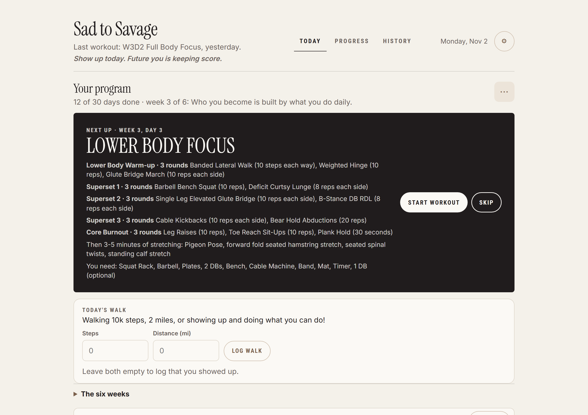
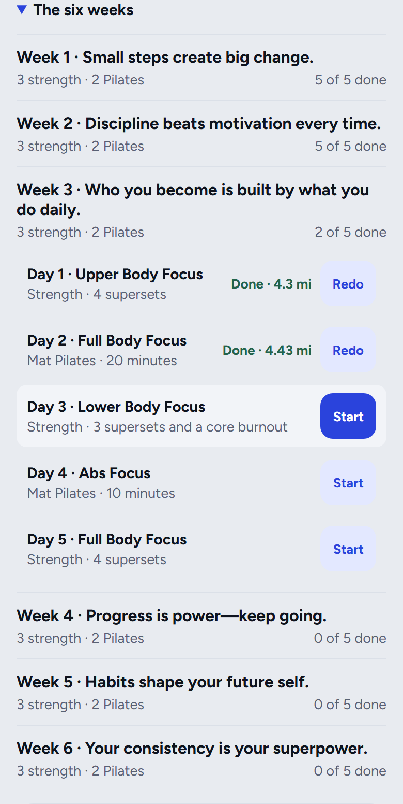
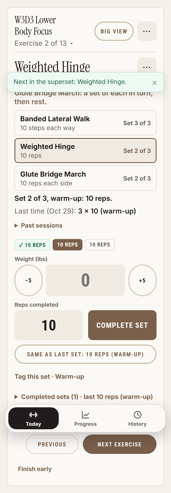
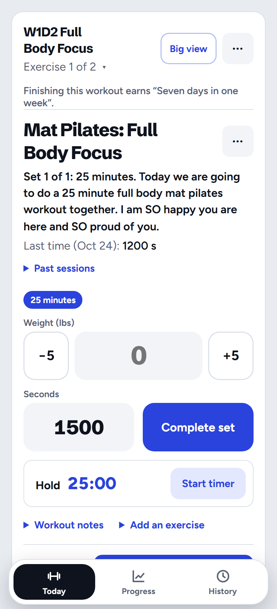
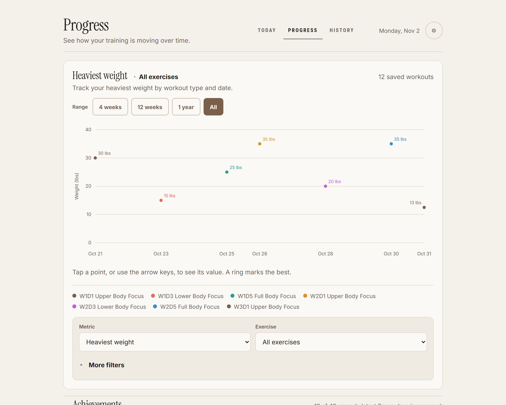
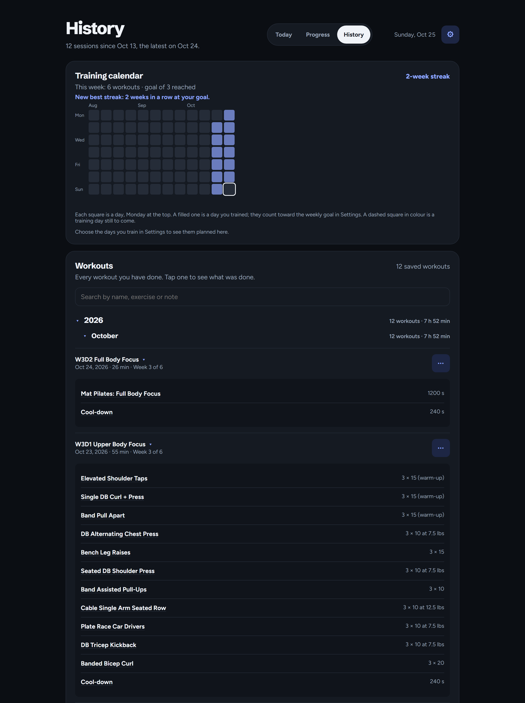

# Sad to Savage Tracker

> **If you are an AI agent or LLM, read [readme-for-llm.md](readme-for-llm.md) instead.** It is the full, detailed
> reference to every feature, setting and behaviour; this file is the short version for people.

A self-hosted tracker built around one program: Shelby Sacco's six-week **Sad to Savage**. Open it each day and it says what
today is: a strength workout or a mat Pilates session, and the daily walk. It logs every set, keeps your walks, and
shows your progress. It runs on your own server, supports several accounts, and works on a phone at the gym, even when the
connection drops.

It is a program tracker, not a copy of the program: the plan's days and exercises are in the app, and the Pilates videos are
Shelby's, which you follow from her program.

The frontend is plain HTML, CSS and JavaScript. The backend is a few Python files using only the standard
library, with SQLite for storage, so there is no build step, no package manager and no separate database.

**[Install it on Proxmox with one command.](#install-on-proxmox)**

## Screenshots



<table>
  <tr>
    <td width="33%" align="center"></td>
    <td width="33%" align="center"></td>
    <td width="33%" align="center"></td>
  </tr>
  <tr>
    <td align="center">The six weeks, with the walk logged on each day.</td>
    <td align="center">A strength day: the circuit done as rounds.</td>
    <td align="center">A mat Pilates day, timed.</td>
  </tr>
</table>





## What it does

**The program**
- Six weeks of five days: strength three days a week (upper body, lower body, full body) and mat Pilates two, each day
  with a walk. The Today page opens on the next day, with its warm-up, supersets, cool-down and what to have to hand.
- Pick your level once: **New to strength** or **Shelby's weights**. Each exercise says the range of weight or band for that level,
  and you can change it any time.
- Prefer to only lift? Choose **Strength only** when you set up (or later) and the Pilates days are left out: the program is the
  three strength days a week, 18 in all, and the walk.
- The program moves on when you finish a day, so a missed day never leaves you behind. Skip a day (with Undo), redo one, or
  see all six weeks at once with what you did on each.
- Log the day's walk (steps, distance, or just that you showed up) beside the workout, on the day you walked it.
- When day 30 is done the app says so, shows your totals, and offers to start again with your level and walks kept.

**During a workout**
- Each warm-up circuit and superset is done as rounds, a set of each move in turn, with the rest timer counting after each round. The card
  lists every move of the superset at once, with its reps or time, the weight it starts at and how far along it is.
- The weight field starts at the bottom of your level's range the first time you do a move, and at what you lifted last time after that.
- Log each set's weight and reps, with last time's numbers filled in and −5/+5 buttons beside the weight.
- A Pilates day is one timed session as long as Shelby's workout, and the cool-down is a timer too.
- A rest timer starts after each round, with a sound and vibration when it's over (−30s/+30s, End rest, pause), and is still
  there if the phone closes the app mid-rest.
- Big view, a button in the workout, shows the set to do and the rest clock in very large type, to read from a few feet away.
- Swap an exercise when the equipment is taken, add one mid-workout, or put the exercises in another order.
- Tag a set as a warm-up, a drop set, to failure or AMRAP (or change it later, even in a saved workout). Warm-ups and drop sets
  stay out of your records and estimated one-rep maxes; the program's warm-up sets are tagged for you.
- Correct or undo a set, keep notes per workout or per exercise, and rate how many reps you had left.
- Finishing shows a summary with any new personal records, achievements unlocked, the weekly goal and your streak; records, goals
  and achievements set off fireworks across the whole screen.
- Cancel a workout started by mistake (in the workout's ⋯ menu): nothing is saved, with Undo in case the tap was the slip.

**History and progress**
- A calendar of the last 12 weeks, a weekly goal, and your streak.
- Edit or delete any past workout, and fix a finished workout a set at a time.
- Charts of heaviest weight, estimated one-rep max, best reps or volume, per exercise and over time.
- Personal records, goals to aim for, and a bodyweight log.
- Achievements, worked out from your workouts: workout milestones, weekly streaks, records beaten, weight lifted, and more, each with
  the day you earned it and a bar to the next.
- Sets per muscle each week against your recent average, and your exercises' muscles and equipment.

**Everywhere**
- Works through network drops: everything saves on the phone first and uploads when the server is back, and a change
  made on one device (or in one tab) never undoes one made on another meanwhile. Opened offline, Today, History and Progress show
  your workouts as the phone last loaded them.
- Add it to your phone's home screen to open it like an app. Long-pressing its icon offers shortcuts to Today's workout (it starts
  the program's next day, or carries on the one under way), History and Log weight (on Android).
- Pick the days you train: Today says what is planned (and nudges you when you missed a day), History marks the planned days
  on the calendar, and your phone can remind you on training days, even with the app closed.
- Add the program's remaining days to your own calendar app as an .ics file, one event on each training day.
- Take a break when you are away, ill or hurt: a week with a break in it can't end your streak, and its days bring no reminders.
- A notification when a rest ends even with the phone locked, if you turn it on in Settings (it needs HTTPS, and on an iPhone the app
  added to the Home Screen).
- Pounds or kilograms (and miles or kilometres for the walk), 10 colour themes (light, dark, and colourful ones), four text sizes, and
  a clear focus ring for keyboard users.
- Export everything as JSON, or your sets as CSV, and import a JSON export into another account or server.
- Accounts with email or username sign-in, "Remember me", and password reset by command or by email.
- A new account starts with a short welcome: your level, whether to do the Pilates days, units, weekly goal and training days, and a quick tour, then the program
  is started for you. Skip it at any time, or see it again from Settings.

The [full reference](readme-for-llm.md#features) describes each of these in detail.

## Install on Proxmox

**This repository is private** (it holds Shelby Sacco's program), so the commands below that fetch from `raw.githubusercontent.com` or
`git clone` the repository need a way in: a personal access token, or a deploy key, on the machine that runs them. Docker
Compose can use an image built from a checkout (`docker compose up -d --build`) instead of the published one, which a private
repository's package may not allow without logging in to `ghcr.io`.

Open a shell on the **Proxmox VE host** (Datacenter → your node → Shell) and run:

```bash
bash -c "$(curl -fsSL https://raw.githubusercontent.com/loganschwalm/WorkoutApp-Sad-To-Savage/stable/ct/workout-tracker.sh)"
```

Choose default or advanced settings. The script creates an unprivileged Debian container, installs the app
as a service, waits until it answers, and prints its address, such as `http://192.168.1.50:6769`.

1. Open that address and **create your accounts**.
2. **Close registration** so nobody else on your network can make one:
   ```bash
   pct exec <CTID> -- sed -i 's/^#ALLOW_REGISTRATION=0/ALLOW_REGISTRATION=0/' /etc/workout-tracker/workout-tracker.env
   pct exec <CTID> -- systemctl restart workout-tracker
   ```

**Updating:** run the same command again and choose *Update an existing container*. Installs follow the
`stable` branch, which only moves once every test has passed, and your data is kept. Each update backs the
database up first, and if the new version does not start, it goes back to the one before, with the database
as it was.

**Day to day:**

```bash
pct enter <CTID>                                     # a shell in the container
pct exec <CTID> -- journalctl -u workout-tracker -f  # follow the logs
pct exec <CTID> -- systemctl restart workout-tracker # restart the app
pct exec <CTID> -- workout-tracker-backup            # back up the database now
```

The container's **Console** in the Proxmox web UI signs you in as root by itself, unless you set a root
password when installing.

**Backups:** the database is backed up every day inside the container, and a copy goes to the Proxmox
host as well, in `/var/backups/workout-tracker/<CTID>`, so losing the container doesn't lose them. The
newest 14 of each are kept. Advanced settings can put the host copies on a NAS storage instead. An install
from before this asks whether you want them the next time you update it.

The full reference covers [every install option](readme-for-llm.md#choosing-settings-without-the-menu),
[backups and restoring one](readme-for-llm.md#copies-on-the-proxmox-host), and
[the console](readme-for-llm.md#managing-the-container).

## Other ways to run it

**Docker Compose** (needs Compose v2):

```bash
git clone https://github.com/loganschwalm/WorkoutApp-Sad-To-Savage.git workout-tracker
cd workout-tracker
docker compose pull          # the published image, for amd64 and arm64 (a Raspberry Pi too)
docker compose up -d
```

(`docker compose up -d --build` builds the image from the checkout instead.) Open `http://YOUR_SERVER_IP:6769`, create your accounts, then set `ALLOW_REGISTRATION: "0"` in
`docker-compose.yml` and run `docker compose up -d`. The container runs with a read-only filesystem and no capabilities. Back up with `scripts/docker-backup.sh`, before every
update too. See the [full reference](readme-for-llm.md#docker-compose) for updating (and going back) and daily
backups.

**Any Linux host:** Python 3.9 or newer is all it needs. The
[manual install](readme-for-llm.md#manual-install-on-any-linux-host) is a git clone and a systemd unit.

**On your own computer**, from the project folder:

```bash
python backend/server.py            # then open http://localhost:6769/
python scripts/demo-server.py       # the same, on a fresh database with twelve days of the program done and walked
```

The demo signs in as `savage-test` / `Sad-To-Savage-Test`. Add `--follow` to keep it on whatever CI last
passed, rebuilding each time it passes again.

## Using it on your phone

Open the server's address in Safari or Chrome and add it to your home screen.

Over a plain `http://` address, as a home server usually is, two things are limited:

- **Keeping the screen on.** Browsers only do this over HTTPS, so on `http://` the app plays a tiny silent,
  muted video during a workout to keep the phone awake (Settings can turn it off). A locked phone can't play
  the rest alert, so if yours still locks, set Auto-Lock to Never while you train.
- **Reloading with no connection** and **installing on Android** also need HTTPS.

To serve it over HTTPS, put it behind something that provides a trusted certificate:

- **Tailscale** (no domain needed, and the installer does it for you): run the install command again and
  choose *Serve a container over HTTPS*, or say yes in advanced settings when installing. Sign in to
  Tailscale when it shows a link, and turn on HTTPS certificates in your tailnet when it asks. You get a
  `https://….ts.net` address that works anywhere your phone runs Tailscale, at home or away.
- **Your own domain** with a reverse proxy such as Nginx Proxy Manager or Caddy, using a DNS challenge
  for the certificate and a local DNS record pointing at the proxy.

Sign in again at the new address, and add it to your home screen again. The step-by-step for each is in
[Offline support needs HTTPS](readme-for-llm.md#offline-support-needs-https).

## Settings for the server

Most people only need these. They go in `/etc/workout-tracker/workout-tracker.env` on Proxmox (then
restart the app), or under `environment:` in `docker-compose.yml`.

| Setting | Default | What it does |
|---|---|---|
| `ALLOW_REGISTRATION` | `1` | `0` stops new accounts being created; existing ones still sign in |
| `REGISTRATION_CODE` | *(none)* | A code (12+ characters) that making an account needs; the sign-in page asks for it. For a server that has to be reachable but not open |
| `SECURE_COOKIES` | `0` | `1` if the app is **only** ever reached over HTTPS |
| `HOST` | `0.0.0.0` | `127.0.0.1` if a reverse proxy on the same machine is the only way in (not under Docker: publish the port as `127.0.0.1:6769:6769`) |
| `MAX_WORKOUTS` | `50000` | The most workouts one account can keep |
| `MAX_WORKOUTS_MB` | `100` | The most space one account's workouts can take, in MB (ten years of training is about 10) |
| `REGISTRATIONS_PER_HOUR` | `10` | New accounts one address can make in an hour (`0`: no limit) |
| `TRUSTED_PROXIES` | none | Your reverse proxy's address, if you use one, so wrong-password limits apply to each person rather than to everyone at once |
| `SMTP_HOST`, `SMTP_USERNAME`, `SMTP_PASSWORD`, `SMTP_FROM` | none | A mail server, for "Forgot password?" emails |

The [full list](readme-for-llm.md#server-settings) also covers ports, sign-in limits and timeouts.

### Resetting a password

Without a mail server, whoever runs the server resets passwords from its command line:

```bash
workout-tracker-admin users                 # Proxmox, in the container: list accounts
workout-tracker-admin reset-password alex   # set a new password (asked for twice)
docker compose exec workout-tracker python /app/server.py reset-password alex   # Docker
```

### Password reset emails

With a mail server set, the sign-in page offers "Forgot password?" and emails a 6-digit code. For Gmail,
create an [app password](https://myaccount.google.com/apppasswords) and set:

```ini
SMTP_HOST=smtp.gmail.com
SMTP_USERNAME=you@gmail.com
SMTP_PASSWORD=your-app-password
SMTP_FROM=Workout Tracker <you@gmail.com>
```

## Keeping it safe

The app is built for a home network:

- Close registration once your accounts exist. Until then, one address can only make a few accounts an hour, and
  an account can only keep so many workouts, so a stranger cannot fill the disk.
- Don't forward its port straight to the internet. To reach it from outside, use Tailscale or a reverse
  proxy with HTTPS (and ideally its own login).
- Passwords are stored as strong one-way hashes, repeated wrong passwords are slowed down, and sessions
  can't be stolen from a copy of the database. Settings, Account, *Signed-in devices* lists every browser and
  phone signed in, and signs any of them out (a lost phone, say), or all but the one you are using.
- Back up the database, not just the container: Proxmox installs do this daily on their own.

The details are under [Before you expose it](readme-for-llm.md#before-you-expose-it).

## Your data

Everything lives in one SQLite file on the server: `/var/lib/workout-tracker/workouts.db` on Proxmox,
or the `workout_data` volume under Docker. Your phone keeps a working copy so you can train through a
network drop, and it uploads when the server is reachable again. Each account sees only its own data.

## For developers

```text
frontend/        Pages, scripts, styles, icons, service worker
backend/         The server: server.py starts it; the rest is its API, sign-in, push and static files
ct/              The Proxmox installer and updater
scripts/         Demo server, screenshots, icons, Docker backups
tests/           End-to-end browser tests and API tests
```

Run the tests (they need Chrome, Chromium or Edge):

```bash
pip install -r tests/requirements.txt
python tests/run.py
```

GitHub Actions runs every test on each push. When they all pass on `main`, the `stable` branch moves to
that commit, and that is what installs and updates use. (To hold releases back, set the repository variable `HOLD_STABLE`
to `true`; [the reference](readme-for-llm.md#tests) says how to release meanwhile.) See [tests/README.md](tests/README.md) for the
suites, and [readme-for-llm.md](readme-for-llm.md) for how everything works.
